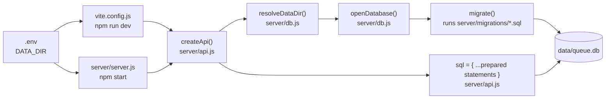
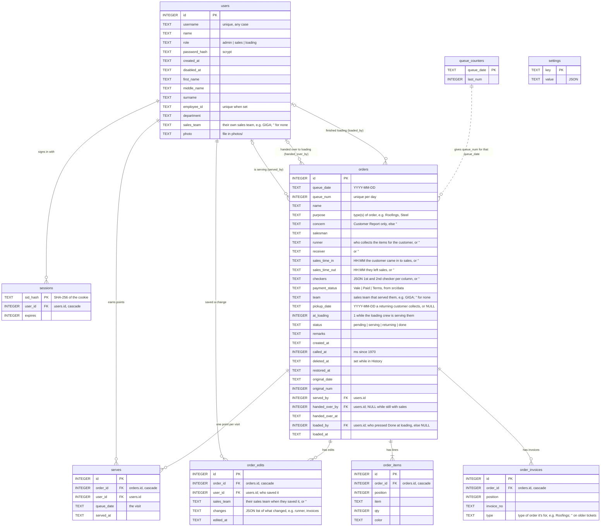

# Database

How the app stores its data, where every piece is wired up in the code, and how to check it yourself.

> Line numbers below match the code as of the My account update. If the code has changed since, search for the function or query name instead.

## At a glance

| | |
|---|---|
| Engine | SQLite, built into Node.js (`node:sqlite`, Node 22.13 or newer). Nothing else to install. |
| File | `queue.db` in the data folder: `data/` in the project by default, or `DATA_DIR` in `.env` |
| Opened by | [`server/db.js`](server/db.js) → `openDatabase()` |
| Used by | [`server/api.js`](server/api.js): every `/api` route runs its SQL through prepared statements in one `sql` object |
| Table definitions | [`server/migrations/`](server/migrations/): numbered `.sql` files, run once each at start |
| Backups | [`server/backup.js`](server/backup.js) (`npm run backup`) |

The browser never talks to the database. It calls the API (`/api/...`), and only `server/api.js` runs SQL.

```
Browser page ──fetch /api/...──▶ server/api.js ──prepared SQL──▶ data/queue.db
(src/...)                         (the only code that touches the database)
```

## 1. Where the data lives

```
data/                    created on first start; ignored by git
  queue.db               the database
  queue.db-wal           recent changes not yet folded into queue.db (see "WAL" below)
  queue.db-shm           index for the -wal file
  videos/                the uploaded display video (the database stores only its file name)
  photos/                staff profile photos (users.photo stores only each file's name)
  backups/               npm run backup writes here unless BACKUP_DIR is set
```

**WAL mode:** new writes go into `queue.db-wal` first and are folded into `queue.db` from time to time, and when the server stops. The app always sees everything. Some database viewers read only `queue.db`, so stop the server before opening the file in one.

## 2. How the app connects



### 2.1 Configuration: `.env`

[`.env.example:17-20`](.env.example#L17-L20)

```ini
# Folder for the database (queue.db), the uploaded display video and backups.
# Default: data\ inside this project. On the Windows server, keep it outside the app folder
# so updating the app never touches the data:
# DATA_DIR=C:\SheehanQueue\data
```

### 2.2 Two ways the server starts, both through `createApi()`

During development, Vite runs the API inside the dev server. [`vite.config.js:18-25`](vite.config.js#L18-L25)

```js
const api = createApi({
  adminUsername: env.ADMIN_USERNAME,
  adminPassword: env.ADMIN_PASSWORD,
  dataDir: env.DATA_DIR,
})
server.middlewares.use('/api', api)
// let go of the database when Vite restarts or stops
server.httpServer?.once('close', api.close)
```

In production (the Windows server), `npm start` runs the same API next to the built site. [`server/server.js:77-81`](server/server.js#L77-L81)

```js
const api = createApi({ adminUsername: ADMIN_USERNAME, adminPassword: ADMIN_PASSWORD, dataDir: DATA_DIR });

const server = createServer((req, res) => {
    const { pathname } = new URL(req.url, "http://localhost");
    if (pathname === "/api" || pathname.startsWith("/api/")) return api(req, res);
```

### 2.3 `createApi()` opens the database once

[`server/api.js:330-338`](server/api.js#L330-L338)

```js
export function createApi({ adminUsername, adminPassword, dataDir }) {
    const dir = resolveDataDir(dataDir);
    const videosDir = join(dir, "videos");
    mkdirSync(videosDir, { recursive: true });
    const db = openDatabase(dir);

    const sql = {
```

Every query the app uses is prepared once in that `sql` object (lines 329-456). Each route then calls one, for example `sql.insertOrder.run(...)`.

### 2.4 Finding the folder: `resolveDataDir()`

[`server/db.js:14-16`](server/db.js#L14-L16)

```js
// DATA_DIR from .env, relative to the project; data/ in the project by default
// (resolved here, not from the working directory, which is System32 when run as a Windows service)
export const resolveDataDir = (dir) => resolve(PROJECT_ROOT, dir || 'data');
```

### 2.5 Opening the file: `openDatabase()`

[`server/db.js:49-59`](server/db.js#L49-L59)

```js
export function openDatabase(dataDir) {
    mkdirSync(dataDir, { recursive: true });
    const db = new DatabaseSync(join(dataDir, DB_FILE));
    db.exec(`
        PRAGMA journal_mode = WAL;   -- display screens keep reading while an order is being saved
        PRAGMA foreign_keys = ON;
        PRAGMA busy_timeout = 5000;  -- wait for another writer instead of failing straight away
    `);
    migrate(db);
    return db;
}
```

`foreign_keys = ON` is what makes the relationships in section 4 enforced. Without it, SQLite would accept an `order_items` row pointing at an order that doesn't exist.

### 2.6 All-or-nothing saves: `transaction()`

[`server/db.js:18-29`](server/db.js#L18-L29)

```js
// runs fn inside one transaction: everything is saved, or nothing is
export function transaction(db, fn) {
    db.exec('BEGIN IMMEDIATE');
    try {
        const result = fn();
        db.exec('COMMIT');
        return result;
    } catch (err) {
        db.exec('ROLLBACK');
        throw err;
    }
}
```

It's used wherever one action writes several rows, for example a new order plus its items, or a status change plus a point.

## 3. Migrations: how the tables are created and changed

[`server/db.js:31-47`](server/db.js#L31-L47)

```js
function migrate(db) {
    db.exec(`CREATE TABLE IF NOT EXISTS schema_migrations (
        name        TEXT PRIMARY KEY,
        applied_at  TEXT NOT NULL
    )`);
    const applied = new Set(db.prepare('SELECT name FROM schema_migrations').all().map((row) => row.name));
    const pending = readdirSync(MIGRATIONS_DIR).filter((file) => file.endsWith('.sql') && !applied.has(file)).sort();

    for (const file of pending) {
        const sql = readFileSync(new URL(file, MIGRATIONS_DIR), 'utf8');
        transaction(db, () => {
            db.exec(sql);
            db.prepare('INSERT INTO schema_migrations (name, applied_at) VALUES (?, ?)').run(file, new Date().toISOString());
        });
        console.log(`Database: applied migration ${file}`);
    }
}
```

On every start, any `.sql` file not yet listed in `schema_migrations` runs, in name order, inside a transaction. A new install gets every table; an existing database gets only what's new, and its data stays.

| File | What it does |
|---|---|
| [`001_init.sql`](server/migrations/001_init.sql) | `orders`, `order_items`, `queue_counters`, `settings`, first `sessions` |
| [`002_ticket_history.sql`](server/migrations/002_ticket_history.sql) | adds `deleted_at`, `restored_at`, `original_date`, `original_num` to `orders` (Delete → History → Restore) |
| [`003_staff_accounts.sql`](server/migrations/003_staff_accounts.sql) | `users`, `serves` (points), `orders.served_by`; rebuilds `sessions` to point at `users` |
| [`004_staff_profiles.sql`](server/migrations/004_staff_profiles.sql) | adds `first_name`, `middle_name`, `surname`, `employee_id`, `department`, `photo` to `users` (My account), filling first name and surname from existing names |
| [`005_customer_reports.sql`](server/migrations/005_customer_reports.sql) | adds `concern` to `orders`: a Customer Report's concern, in place of `order_items` (`''` on every order) |
| [`006_returning_customers.sql`](server/migrations/006_returning_customers.sql) | rebuilds `orders` to allow the `returning` status (back in line after being served) |
| [`007_loading_staff.sql`](server/migrations/007_loading_staff.sql) | rebuilds `users` to allow the `loading` role (the roofing and steel loading crews) |
| [`008_sales_details.sql`](server/migrations/008_sales_details.sql) | adds `invoice_no`, `salesman`, `payment_status`, `team`, `pickup_date` to `orders` (Customer order as sales staff fill it in) |
| [`009_loading_teams.sql`](server/migrations/009_loading_teams.sql) | adds `team` to `users` (a loading account's crew) and `serving_team`, `teams_done` to `orders` (which crew has the customer now, and which have finished) |
| [`010_loading_handover.sql`](server/migrations/010_loading_handover.sql) | adds `handed_over_by`, `handed_over_at` to `orders`: the sales staff member who pressed Hand over to loading on My counter, and when; the crews can only call a customer once it's set |
| [`011_order_invoices.sql`](server/migrations/011_order_invoices.sql) | `order_invoices`: several invoices per ticket, each with the type of order it's for; moves each ticket's `invoice_no` into it (typed when the ticket has one type of order) and drops `orders.invoice_no` |
| [`012_runner_name.sql`](server/migrations/012_runner_name.sql) | adds `runner` to `orders`: the person a customer sends to collect the items for them (`''` when they collect them themselves) |
| [`013_receiver_sales_times.sql`](server/migrations/013_receiver_sales_times.sql) | adds `receiver`, `sales_time_in`, `sales_time_out` to `orders`: the receiver's name and the times (HH:MM) the customer came in to sales and left it, each `''` when left blank; like the runner, never printed on the ticket |
| [`014_order_checkers.sql`](server/migrations/014_order_checkers.sql) | adds `checkers` to `orders`: the 1st and 2nd checker for each column of [`src/data/checkers.js`](src/data/checkers.js) (Roofing, Construction, Hardware/TBA/Chassis) as JSON with only the columns that have a name, e.g. `{"Roofing":["Pedro",""]}`; `''` while none is filled in (the ticket then has blank lines to write them on by hand) |
| [`015_shared_loading.sql`](server/migrations/015_shared_loading.sql) | one shared loading line (Roofings and Steel are departments, not teams): adds `at_loading` to `orders` (1 while the loading crew is serving the customer), drops `orders.serving_team`, `orders.teams_done` and `users.team`, and takes Roofings and Steel off `orders.team`, which is now the sales team that served the customer |
| [`016_loaded_by.sql`](server/migrations/016_loaded_by.sql) | adds `loaded_by`, `loaded_at` to `orders`: loading isn't serving, so Done at loading means the crew has finished loading the order; the loading staff member who pressed Done is kept here and `served_by` stays the sales staff member who handed it over (orders loading had already finished are moved over the same way) |
| [`017_order_edits.sql`](server/migrations/017_order_edits.sql) | Edited by: adds `sales_team` to `users` (each staff member's own sales team, set by an admin on Accounts; `''` for none) and the `order_edits` table: every save on Customer order that changes something, with who saved it, their sales team at the time, which details changed and when |

**Changing the tables later:** never edit a file that has already run anywhere. Add the next number instead, for example `server/migrations/006_add_counter_number.sql`:

```sql
-- which window/counter served the ticket
ALTER TABLE orders ADD COLUMN counter TEXT;
```

Restart the app, and you'll see `Database: applied migration 006_add_counter_number.sql` in the terminal.

## 4. Tables and relationships



The relationships, as SQLite reports them (`PRAGMA foreign_key_list`):

| From | To | On delete | Defined in |
|---|---|---|---|
| `order_items.order_id` | `orders.id` | cascade: the lines go with the order | [`001_init.sql:20-27`](server/migrations/001_init.sql#L20-L27) |
| `orders.served_by` | `users.id` | — | [`003_staff_accounts.sql:25`](server/migrations/003_staff_accounts.sql#L25) |
| `orders.handed_over_by` | `users.id` | — | [`010_loading_handover.sql`](server/migrations/010_loading_handover.sql) |
| `orders.loaded_by` | `users.id` | — | [`016_loaded_by.sql`](server/migrations/016_loaded_by.sql) |
| `order_invoices.order_id` | `orders.id` | cascade: the invoices go with the order | [`011_order_invoices.sql`](server/migrations/011_order_invoices.sql) |
| `order_edits.order_id` | `orders.id` | cascade: the edits go with the order | [`017_order_edits.sql`](server/migrations/017_order_edits.sql) |
| `order_edits.user_id` | `users.id` | — (accounts are switched off, never deleted, so edits stay) | same |
| `serves.order_id` | `orders.id` | cascade | [`003_staff_accounts.sql:29-36`](server/migrations/003_staff_accounts.sql#L29-L36) |
| `serves.user_id` | `users.id` | — (accounts are switched off, never deleted, so points stay) | same |
| `sessions.user_id` | `users.id` | cascade | [`003_staff_accounts.sql:18-22`](server/migrations/003_staff_accounts.sql#L18-L22) |
| `orders.queue_date` ↔ `queue_counters.queue_date` | — | not a foreign key; matched by date | [`001_init.sql:32-35`](server/migrations/001_init.sql#L32-L35) |

Unique rules: `orders (queue_date, queue_num)`, `users.username` (any case), `users.employee_id` (any case; any number of accounts can leave it empty), `serves (order_id, queue_date)` (one point per ticket per visit).

Orders are never deleted from the app. Delete only sets `deleted_at`, so the cascades above apply only if a row is removed by hand.

### What each table is for, and where the code uses it

| Table | Holds | Written by (`server/api.js`) | Read by |
|---|---|---|---|
| `orders` | one row per ticket | `insertOrder` (L334), `updateOrder` (L335), `setStatus` (L336), `deleteOrder` (L345), `restoreSameDay` / `restoreToToday` (L384-393) | `findOrder`, `findById`, `dayOrders` (L346-348), `serving` / `upcoming` (L349-354), `history` (L373), stats (L356-371) |
| `order_invoices` | the invoices of each order, with their type of order | `saveInvoices()` → `deleteInvoices` + `insertInvoice` | `orderInvoices`, `dayInvoices`, `invoicesFor` |
| `order_edits` | every save on Customer order that changed something: who, their sales team then, what changed, when | `insertEdit`, in `PUT /admin/orders/:queueNum` when `changedDetails()` finds a change | `orderEdits`, `dayEdits`, `editsFor` → `edits` on each order (`toEdit()`) |
| `order_items` | the lines of each order | `saveItems()` → `deleteItems` + `insertItem` (L493-496) | `orderItems`, `dayItems` (L396-399), `itemsFor` (L380), stats joins |
| `queue_counters` | last number given out each day | `nextQueueNum` (L330-333), on a new order and on a restore from an earlier day | same statement (`RETURNING last_num`) |
| `users` | staff accounts and their profiles | built-in admin (L461-463), `insertUser` (L417), `updateUser` (L421), `updateProfile` (L426), `setPhoto` (L431) | `findUser` (L415), `findSession` join (L405), `ORDER_ROW` join (L313), `listUsers` (L432) |
| `sessions` | who is signed in | `insertSession` (L403), `deleteSession`, `deleteExpiredSessions`, `deleteUserSessions` (L410-413) | `findSession` (L405) |
| `serves` | the points | `addPoint` / `removePoint` (L340-343), from `changeStatus()` (L478-487), and `addPoint` on Hand over to loading (the point is the sales counter's; the crews finishing or reopening the order leave it alone) | `listUsers` (L432-437), `myTotals` / `myByHour` / `myByDay` / `myByMonth` (L440-455) |
| `settings` | display video and announcer settings, as JSON | `writeSetting()` (L502) | `readSetting()` (L498) |
| `schema_migrations` | which migration files have run | `migrate()` in `server/db.js` | `migrate()` |

## 5. Follow a request through the code

Each walkthrough starts at the page, goes through the API call, and ends at the rows written.

### 5.1 A customer submits an order → `queue_counters`, `orders`, `order_items`

Staff send the order from Admin → Customer order. [`src/admin/pages/customerOrderPage.jsx:76-77`](src/admin/pages/customerOrderPage.jsx#L76-L77)

```js
                ? await updateOrder(submitted.queueNum, payload)
                : await createOrder(payload);
```

[`src/api/orderController.js:7`](src/api/orderController.js#L7), sent to `/api` (see [`src/api/http.js:2`](src/api/http.js#L2))

```js
export const createOrder = (order) => http.post("/orders", order);
```

The server takes the next number for today, saves the order (with its salesman, runner, receiver, sales times, checkers, payment status, team and pick-up day), then its lines and its invoices, all in one transaction. Orders from Customer order have no lines (the invoice lists the items), so `saveItems` writes none for them. [`server/api.js`](server/api.js)

```js
if (method === "POST" && path === "/orders") {
    const body = await readBody(req);
    if (!validOrder(body)) return send(res, 400, { message: "Invalid order." });
    const { orders: items, ...fields } = pickOrder(body);
    const order = transaction(db, () => {
        const date = today();
        // a plain number; the front end formats it as "SHN 01"
        const { last_num: queueNum } = sql.nextQueueNum.get(date);
        const { lastInsertRowid } = sql.insertOrder.run({ ...fields, date, queueNum, createdAt: new Date().toISOString() });
        saveItems(lastInsertRowid, items);
        return loadOrder(sql.findOrder.get(date, queueNum));
    });
    return send(res, 201, order);
}
```

The new `orders.id` (`lastInsertRowid`) becomes `order_items.order_id` for a ticket that has lines. [`server/api.js:502-505`](server/api.js#L502-L505)

```js
const saveItems = (orderId, items) => {
    sql.deleteItems.run(orderId);
    items.forEach(({ item, qty, color }, i) => sql.insertItem.run(orderId, i, item, qty, color ?? null));
};
```

The daily counter gives out the number; a deleted ticket's number is never reused. [`server/api.js:339-342`](server/api.js#L339-L342)

```js
nextQueueNum: db.prepare(`
    INSERT INTO queue_counters (queue_date, last_num) VALUES (?, 1)
    ON CONFLICT (queue_date) DO UPDATE SET last_num = last_num + 1
    RETURNING last_num`),
```

### 5.2 The queue display reads today's board → `orders`

[`src/pages/QueueNum.jsx:32`](src/pages/QueueNum.jsx#L32) polls `GET /api/queue` every 5 seconds:

```js
setQueue(await getQueue({ signal: controller.signal }));
```

[`server/api.js:358-363`](server/api.js#L358-L363): only today's, never deleted ones, and never order details

```js
serving: db.prepare(`
    SELECT queue_num, name, purpose, remarks, called_at FROM orders
    WHERE queue_date = ? AND status = 'serving' AND deleted_at IS NULL ORDER BY called_at DESC`),
upcoming: db.prepare(`
    SELECT queue_num, name, purpose, status FROM orders
    WHERE queue_date = ? AND status IN ('pending', 'returning') AND deleted_at IS NULL ORDER BY queue_num`),
```

### 5.3 Staff serve a customer → `orders.served_by` and `serves` (points)

The sales counter's **Serve** and **Recall** buttons call [`src/admin/pages/salesPage.jsx:69`](src/admin/pages/salesPage.jsx#L69):

```js
replace(await callOrder(queueNum, remarks));
```

…and **Done** and **Back to waiting** call [`src/admin/pages/salesPage.jsx:49`](src/admin/pages/salesPage.jsx#L49), with `"done"` or `"pending"`:

```js
replace(await updateOrderStatus(order.queueNum, status));
```

[`src/admin/api/adminOrderController.js:10-15`](src/admin/api/adminOrderController.js#L10-L15)

```js
export const updateOrderStatus = (queueNum, status) =>
    http.patch(`/admin/orders/${encodeURIComponent(queueNum)}`, { status });

// puts the ticket on the display as now serving; remarks replace the default "Please wait" line
export const callOrder = (queueNum, remarks) =>
    http.post(`/admin/orders/${encodeURIComponent(queueNum)}/call`, { remarks });
```

Both routes end in `changeStatus()`, with the signed-in account (`me`) as the person serving. [`server/api.js:888-889`](server/api.js#L888-L889) and [`:881-882`](server/api.js#L881-L882)

```js
// whoever calls the customer is the one serving them
changeStatus(order, "serving", me, { calledAt: Date.now(), remarks: remarks.trim(), servedBy: me.id });
```

```js
const calledAt = status === "serving" && order.status !== "serving" ? Date.now() : order.called_at;
changeStatus(order, status, me, { calledAt });
```

`changeStatus()` is the one place `orders.served_by` and `serves` are kept in step. [`server/api.js:484-496`](server/api.js#L484-L496)

```js
// moves a ticket to a new status and keeps "who is serving it" and the points in step:
// serving → the person who called it; waiting → nobody; done → a point for whoever served it
// (or whoever marked it done, if nobody called it); leaving done takes that visit's point back
const changeStatus = (order, status, user, { calledAt = order.called_at, remarks = order.remarks, servedBy } = {}) =>
    transaction(db, () => {
        const server = servedBy !== undefined ? servedBy
            : status === "pending" ? null
            : status === "serving" ? (order.status === "serving" ? order.served_by : user.id)
            : order.served_by ?? user.id;
        sql.setStatus.run({ status, calledAt, remarks, servedBy: server, id: order.id });
        if (order.status === "done" && status !== "done") sql.removePoint.run(order.id, order.queue_date);
        if (status === "done") sql.addPoint.run(order.id, server, order.queue_date, new Date().toISOString());
    });
```

The point itself: `ON CONFLICT ... DO NOTHING` plus the unique `(order_id, queue_date)` means marking Done twice still gives one point. [`server/api.js:348-352`](server/api.js#L348-L352)

```js
// a point for the staff member who served this visit; reopening the ticket takes it back
addPoint: db.prepare(`
    INSERT INTO serves (order_id, user_id, queue_date, served_at) VALUES (?, ?, ?, ?)
    ON CONFLICT (order_id, queue_date) DO NOTHING`),
removePoint: db.prepare("DELETE FROM serves WHERE order_id = ? AND queue_date = ?"),
```

**Loading isn't serving.** Once sales hands a customer over, the loading crew calls them from the Loading page, and `served_by` is the loading staff member only while they have the customer (`at_loading = 1`). Their **Done** means they've finished loading the order (the truck, for roofing): `changeStatus()` puts `served_by` back to `handed_over_by`, the sales staff member who served the customer and has the point, and keeps the loading staff member who pressed Done in `loaded_by`, with the time in `loaded_at`. Leaving Done (Returning, a restore) clears both.

### 5.4 Showing who served a ticket → `orders` joined to `users` and `serves`

Every order query uses one shared `FROM` clause that joins the staff member's name and photo, and the time they marked it Done (this visit's point in `serves`, when the point is theirs; `UNIQUE (order_id, queue_date)` keeps it to one row per order). [`server/api.js:323-328`](server/api.js#L323-L328)

```js
const ORDER_ROW = `o.*, u.name AS served_by_name, u.photo AS served_by_photo, s.served_at
    FROM orders o
    LEFT JOIN users u ON u.id = o.served_by
    LEFT JOIN serves s ON s.order_id = o.id AND s.queue_date = o.queue_date AND s.user_id = o.served_by`;
```

…and the row becomes `servedBy: { id, name, photo }`, plus `servedAt` once it's Done, for the pages. [`server/api.js:306-309`](server/api.js#L306-L309) The `ServedBy` tag ([`src/admin/components/servedBy.jsx`](src/admin/components/servedBy.jsx)) shows it as "Served by Maria Santos · 10:42 AM" in Orders, History, the Dashboard and My counter.

```js
// the staff member serving it, or who served it; photo is for their avatar (see photoUrl in the front end)
...(row.served_by !== null && { servedBy: { id: row.served_by, name: row.served_by_name, photo: row.served_by_photo } }),
// when they marked it Done (ISO 8601)
...(row.status === "done" && row.served_at && { servedAt: row.served_at }),
```

### 5.5 Delete and Restore → `orders.deleted_at`, `restored_at`, `original_*`

Delete in Orders ([`src/admin/components/queueTable.jsx:64`](src/admin/components/queueTable.jsx#L64)) only marks the row. [`server/api.js:906-910`](server/api.js#L906-L910)

```js
// moves it to History, where it can be restored
if (method === "DELETE") {
    sql.deleteOrder.run(new Date().toISOString(), order.id);
    return send(res, 204);
}
```

Restore in History ([`src/admin/pages/historyPage.jsx:61`](src/admin/pages/historyPage.jsx#L61)) puts the ticket back in today's queue. A ticket from today keeps its number; one from an earlier day gets today's next number, and its first day and number are kept. [`server/api.js:964-973`](server/api.js#L964-L973)

```js
const restored = transaction(db, () => {
    const now = new Date().toISOString();
    if (row.queue_date === date) {
        sql.restoreSameDay.run(now, row.id);
    } else {
        const { last_num: queueNum } = sql.nextQueueNum.get(date);
        sql.restoreToToday.run(date, queueNum, now, row.id);
    }
    return loadOrder(sql.findById.get(row.id));
});
```

[`server/api.js:397-402`](server/api.js#L397-L402): `COALESCE` keeps the first day and number even if a ticket is restored several times. `served_by` is cleared, but the old visit's row in `serves` stays.

```js
restoreToToday: db.prepare(`
    UPDATE orders SET
        original_date = COALESCE(original_date, queue_date), original_num = COALESCE(original_num, queue_num),
        queue_date = ?, queue_num = ?,
        deleted_at = NULL, restored_at = ?, status = 'pending', called_at = NULL, remarks = '', served_by = NULL
    WHERE id = ?`),
```

### 5.6 Signing in → `users` and `sessions`

The sign-in form calls `authApi.login()` ([`src/admin/auth/authProvider.jsx:40`](src/admin/auth/authProvider.jsx#L40)). [`server/api.js:571-587`](server/api.js#L571-L587)

```js
if (method === "POST" && path === "/auth/login") {
    const { username, password } = await readBody(req);
    const account = typeof username === "string" ? sql.findUser.get(username.trim()) : undefined;
    const passwordOk = await checkPassword(String(password ?? ""), account?.password_hash ?? NO_SUCH_USER);
    if (!account || !passwordOk || account.disabled_at !== null) {
        return send(res, 401, { message: "Incorrect username or password." });
    }
    const user = toMe(account);
    const sid = randomBytes(32).toString("hex");
    sql.deleteExpiredSessions.run(Date.now());
    sql.insertSession.run(sha256(sid), account.id, Date.now() + SESSION_TTL_MS);
    return send(res, 200, user, {
        // no Max-Age: the browser forgets it when it closes, so the next person on a shared PC signs in
        // themselves; the server still ends it after SESSION_TTL_MS
        "Set-Cookie": `${sessionCookieName(req)}=${sid}; HttpOnly; SameSite=Strict; Path=/`,
    });
}
```

The browser keeps the random `sid` in an `HttpOnly` cookie named after the browser tab (`sid_<tab id>`, see below); the database keeps only its SHA-256 (`sessions.sid_hash`) and the account (`sessions.user_id`). `toMe()` turns the account row into what the pages get: name, role and the My account details, never the password hash.

**One sign-in per browser tab.** Every request from the pages carries the tab's id (`X-Tab-Id`, kept in the tab's `sessionStorage`), and the server reads only the cookie named after that tab. So a second tab or window of the same browser starts signed out, and two people can't end up sharing one sign-in on a shared PC. [`src/api/http.js`](src/api/http.js) sends the id; [`server/api.js`](server/api.js) picks the cookie with `sessionCookieName()`.

On every later request, the cookie is looked up and joined to the account, so a switched-off account stops working at once. [`server/api.js:414-418`](server/api.js#L414-L418)

```js
findSession: db.prepare(`
    SELECT s.expires, u.id, u.username, u.name, u.role, u.first_name, u.middle_name, u.surname,
        u.employee_id, u.department, u.sales_team, u.photo
    FROM sessions s JOIN users u ON u.id = s.user_id
    WHERE s.sid_hash = ? AND u.disabled_at IS NULL`),
```

The account's `role` then decides what it may do. [`server/api.js:642-649`](server/api.js#L642-L649), with the sales list at [`server/api.js:33-43`](server/api.js#L33-L43)

```js
// everything below needs a signed-in account; sales and loading staff only get their routes in ROLE_ROUTES
const session = getSession(req);
if (path.startsWith("/auth/") || path.startsWith("/admin/")) {
    if (!session) return send(res, 401, { message: "Please sign in." });
    if (path.startsWith("/admin/") && session.user.role !== "admin" && !roleMay(session.user.role, method, path)) {
        return send(res, 403, { message: "Only an admin can do that." });
    }
}
```

The built-in admin from `.env` is created, or its password updated, every time the server starts. [`server/api.js:469-472`](server/api.js#L469-L472)

```js
// the admin from .env always exists, as an enabled admin with the .env password, so nobody is locked out
const builtIn = sql.findUser.get(adminUsername);
if (builtIn) sql.resetBuiltInAdmin.run(hashPasswordSync(adminPassword), builtIn.id);
else sql.insertUser.run(adminUsername, adminUsername, adminUsername, "", "admin", hashPasswordSync(adminPassword), new Date().toISOString());
```

### 5.7 Accounts page and staff totals → `users` + `serves`

Admin → Accounts ([`src/admin/pages/accCreation.jsx:76`](src/admin/pages/accCreation.jsx#L76)) lists accounts with their points counted from `serves`. [`server/api.js:441-446`](server/api.js#L441-L446)

```js
listUsers: db.prepare(`
    SELECT u.*,
        (SELECT COUNT(*) FROM serves s WHERE s.user_id = u.id) AS served_total,
        (SELECT COUNT(*) FROM serves s WHERE s.user_id = u.id AND date(s.served_at, 'localtime') = ?) AS served_today
    FROM users u
    ORDER BY u.disabled_at IS NOT NULL, u.role, u.name COLLATE NOCASE`),
```

A staff member's own totals on My counter ([`src/admin/components/myStats.jsx:28`](src/admin/components/myStats.jsx#L28)) come from their rows in `serves`. [`server/api.js:449-455`](server/api.js#L449-L455)

```js
myTotals: db.prepare(`
    SELECT COUNT(*) AS total,
        COALESCE(SUM(day = :today), 0) AS today,
        COALESCE(SUM(day >= :week), 0) AS week,
        COALESCE(SUM(day >= :month), 0) AS month,
        COALESCE(SUM(day >= :year), 0) AS year
    FROM (SELECT date(served_at, 'localtime') AS day FROM serves WHERE user_id = :user)`),
```

### 5.8 Dashboard sales graph → `orders`

[`src/admin/components/statistics.jsx`](src/admin/components/statistics.jsx) calls `GET /api/admin/stats`. [`server/api.js`](server/api.js)

```js
statsByDay: db.prepare(`
    SELECT queue_date AS bucket, purpose, COUNT(*) AS orders FROM orders
    WHERE deleted_at IS NULL AND purpose != :report AND queue_date BETWEEN :from AND :to
    GROUP BY bucket, purpose`),
```

The graph counts orders: orders from Customer order have invoices and no item lines, so there are no quantities to add up. The route splits each `purpose` into its types of order, so an order for "Roofings, Steel" counts once for Roofings and once for Steel, and once in the slot's `total` (All products). Deleted tickets and Customer Reports are left out.

### 5.9 Settings → `settings` (JSON per key)

The announcer settings (Admin → Announcer, and the volume on My counter) and the display video are stored as JSON under the keys `announcer` and `video`. [`server/api.js:507-514`](server/api.js#L507-L514)

```js
const readSetting = (key) => {
    const row = sql.getSetting.get(key);
    return row ? JSON.parse(row.value) : null;
};
const writeSetting = (key, value) => {
    if (value === null) sql.deleteSetting.run(key);
    else sql.setSetting.run(key, JSON.stringify(value));
};
```

### 5.10 My account → `users` profile columns and `photos/`

Every staff member edits their own details on **My account** (`/admin/account`). **Update account** in [`src/admin/components/accountForm.jsx:31`](src/admin/components/accountForm.jsx#L31) sends the form:

```js
const updated = await updateMyAccount(form);
```

…to `PATCH /api/admin/me`, which checks each field and saves it on the signed-in account (`me`), never anyone else's. [`server/api.js:791-820`](server/api.js#L791-L820) (shortened here)

```js
if (method === "PATCH" && path === "/admin/me") {
    const body = await readBody(req);
    const text = (value) => (typeof value === "string" ? value.trim() : "");
    const profile = {
        firstName: text(body.firstName),
        middleName: text(body.middleName),
        surname: text(body.surname),
        employeeId: text(body.employeeId) || null,
        department: text(body.department),
    };
    if (profile.employeeId && sql.employeeIdTaken.get(profile.employeeId, me.id)) {
        return send(res, 409, { message: "That employee ID belongs to another account." });
    }
    sql.updateProfile.run({ ...profile, name: displayName(profile.firstName, profile.surname), id: me.id });
    return send(res, 200, toMe(sql.findUserById.get(me.id)));
```

`users.name` is rebuilt from the first name and surname, so "Served by …", the sidebar and Accounts show the new name straight away. [`server/api.js:257-258`](server/api.js#L257-L258) and [`server/api.js:435-439`](server/api.js#L435-L439)

```js
// "Maria" + "Santos" → "Maria Santos", the name shown around the app (users.name)
const displayName = (first, surname) => [first, surname].filter(Boolean).join(" ");
updateProfile: db.prepare(`
    UPDATE users SET name = :name, first_name = :firstName, middle_name = :middleName, surname = :surname,
        employee_id = :employeeId, department = :department
    WHERE id = :id`),
employeeIdTaken: db.prepare("SELECT id FROM users WHERE employee_id = ? COLLATE NOCASE AND id != ?"),
```

**The photo:** the browser crops the picture to its middle square and shrinks it before uploading. [`src/admin/components/profilePhoto.jsx:11-23`](src/admin/components/profilePhoto.jsx#L11-L23)

```js
// the middle square of the picture, shrunk to PHOTO_SIZE, as a JPEG
async function squarePhoto(file) {
    const bitmap = await createImageBitmap(file);
    const side = Math.min(bitmap.width, bitmap.height);
    const canvas = document.createElement("canvas");
    canvas.width = PHOTO_SIZE;
    canvas.height = PHOTO_SIZE;
    canvas
        .getContext("2d")
        .drawImage(bitmap, (bitmap.width - side) / 2, (bitmap.height - side) / 2, side, side, 0, 0, PHOTO_SIZE, PHOTO_SIZE);
    bitmap.close();
    return new Promise((resolve) => canvas.toBlob(resolve, "image/jpeg", 0.9));
}
```

The server only keeps real pictures: the file must start the way a JPEG, PNG or WebP does. It's saved in `photos/`, and only its file name goes into `users.photo`. [`server/api.js:267-272`](server/api.js#L267-L272) and [`server/api.js:824-836`](server/api.js#L824-L836)

```js
// profile photos: the accepted types, and how each file must start, so only real pictures are kept
const PHOTO_TYPES = {
    "image/jpeg": { ext: ".jpg", isIt: (b) => b[0] === 0xff && b[1] === 0xd8 && b[2] === 0xff },
    "image/png": { ext: ".png", isIt: (b) => b.subarray(0, 8).equals(Buffer.from([0x89, 0x50, 0x4e, 0x47, 0x0d, 0x0a, 0x1a, 0x0a])) },
    "image/webp": { ext: ".webp", isIt: (b) => b.toString("ascii", 0, 4) === "RIFF" && b.toString("ascii", 8, 12) === "WEBP" },
};
if (method === "PUT" && path === "/admin/me/photo") {
    const type = PHOTO_TYPES[req.headers["content-type"]];
    if (!type) return send(res, 415, { message: "Upload a JPEG, PNG or WebP picture." });
    if (Number(req.headers["content-length"]) > MAX_PHOTO_BYTES) {
        return send(res, 413, { message: "Photos can be up to 2 MB." });
    }
    const bytes = await readBytes(req, MAX_PHOTO_BYTES);
    if (!type.isIt(bytes)) return send(res, 400, { message: "That file isn't a picture." });
    const file = `user-${me.id}-${Date.now()}${type.ext}`;
    writeFileSync(join(photosDir, file), bytes);
    setPhoto(me.id, file);
    return send(res, 200, toMe(sql.findUserById.get(me.id)));
}
```

Photos are shown only to signed-in staff, from `GET /api/photos/:id`. An `` can't send the tab id, so any signed-in tab of that browser counts (`anySession()`). The file name is part of the URL, so a new photo is never confused with a cached old one. [`src/admin/api/accountController.js:15-16`](src/admin/api/accountController.js#L15-L16) and [`server/api.js:654-660`](server/api.js#L654-L660)

```js
export const photoUrl = (account) =>
    account?.photo ? apiUrl(`/photos/${account.id}?v=${encodeURIComponent(account.photo)}`) : null;
const photoMatch = path.match(/^\/photos\/(\d+)$/);
if (method === "GET" && photoMatch) {
    if (!anySession(req)) return send(res, 401, { message: "Please sign in." });
    const account = sql.findUserById.get(Number(photoMatch[1]));
    const file = account?.photo ? join(photosDir, account.photo) : null;
    const stats = file ? statSync(file, { throwIfNoEntry: false }) : undefined;
    if (!stats) return send(res, 404, { message: "No photo." });
```

### 5.11 Editing an order → `orders`, `order_edits`

Edit on Orders opens the ticket on Customer order, and saving it sends the whole order again. Only a signed-in admin or sales account may: the route is in `ROLE_ROUTES.sales`, and loading gets `403`. [`src/admin/api/adminOrderController.js`](src/admin/api/adminOrderController.js)

```js
export const updateOrder = (queueNum, order) => http.put(`/admin/orders/${encodeURIComponent(queueNum)}`, order);
```

Before saving, `changedDetails()` compares the stored order (its row, items and invoices) with the save. If anything changed, the same transaction adds a row to `order_edits` with the signed-in account, its `users.sales_team` at that moment and the list of what changed. A save that changes nothing adds no row. [`server/api.js`](server/api.js)

```js
transaction(db, () => {
    const changes = changedDetails(order, sql.orderItems.all(order.id), sql.orderInvoices.all(order.id), saved);
    sql.updateOrder.run({ ...fields, id: order.id });
    saveItems(order.id, items);
    saveInvoices(order.id, invoices);
    if (changes.length) {
        sql.insertEdit.run(order.id, me.id, me.team, JSON.stringify(changes), new Date().toISOString());
    }
});
```

Every order the pages get carries its edits, newest first, as `edits: [{ by: { id, name, photo }, team?, changes, at }]`. The team is copied into the edit, so moving someone to another team later doesn't change the edits they already made. [`src/admin/components/editedBy.jsx`](src/admin/components/editedBy.jsx) shows the newest one on Orders, History and Customer order as "Edited by Maria Santos · GIGA · 12:54 PM" with what changed, and folds the earlier ones under it.

## 6. Check it yourself

### Open the file in VS Code

1. Install the **SQLite Viewer** extension (just for looking) or **SQLite** (also lets you run queries).
2. Stop the dev server first (**Ctrl+C**), so everything in `queue.db-wal` is folded into `queue.db`.
3. Open `data/queue.db`. With the **SQLite** extension: **Ctrl+Shift+P** → **SQLite: Open Database** → then **SQLite: New Query**.

Looking is always safe. Don't edit rows by hand while the app is running; run `npm run backup` first if you ever must.

### Queries that show each relationship

Each of these was run against a database with orders, staff, points and restored tickets.

**An order and its lines** (`order_items.order_id` → `orders.id`)

```sql
SELECT o.queue_date, o.queue_num, o.name, o.purpose, i.position, i.item, i.qty, i.color
FROM orders o
JOIN order_items i ON i.order_id = o.id
ORDER BY o.queue_date DESC, o.queue_num, i.position;
```

**Who is serving each of today's tickets** (`orders.served_by` → `users.id`; same join as `ORDER_ROW`)

```sql
SELECT o.queue_num, o.name AS customer, o.status, u.name AS served_by
FROM orders o
LEFT JOIN users u ON u.id = o.served_by
WHERE o.queue_date = date('now', 'localtime') AND o.deleted_at IS NULL
ORDER BY o.queue_num;
```

**Points per staff member** (`serves.user_id` → `users.id`; compare with Admin → Accounts)

```sql
SELECT u.name, u.role,
       COUNT(s.id) AS total_points,
       COALESCE(SUM(date(s.served_at, 'localtime') = date('now', 'localtime')), 0) AS today
FROM users u
LEFT JOIN serves s ON s.user_id = u.id
GROUP BY u.id
ORDER BY total_points DESC;
```

**Every point and the ticket it came from** (`serves` → `users` and `orders`)

```sql
SELECT s.served_at, u.name AS staff, s.queue_date AS visit, o.queue_num, o.name AS customer
FROM serves s
JOIN users u ON u.id = s.user_id
JOIN orders o ON o.id = s.order_id
ORDER BY s.served_at DESC;
```

**Who is signed in** (`sessions.user_id` → `users.id`)

```sql
SELECT u.username, u.role, datetime(s.expires / 1000, 'unixepoch', 'localtime') AS expires
FROM sessions s
JOIN users u ON u.id = s.user_id;
```

**Deleted and restored tickets** (the History columns)

```sql
SELECT queue_date, queue_num, name, deleted_at, restored_at, original_date, original_num
FROM orders
WHERE deleted_at IS NOT NULL OR restored_at IS NOT NULL;
```

**Daily counters against the tickets kept** (a gap means a ticket was restored to a later day)

```sql
SELECT c.queue_date, c.last_num AS last_number_given, COUNT(o.id) AS tickets_that_day
FROM queue_counters c
LEFT JOIN orders o ON o.queue_date = c.queue_date
GROUP BY c.queue_date
ORDER BY c.queue_date DESC;
```

**Staff profiles** (My account; `name` is what the app shows)

```sql
SELECT username, first_name, middle_name, surname, name AS shown_as,
       employee_id, department, photo, role
FROM users
ORDER BY surname, first_name;
```

**Settings, and the health checks**

```sql
SELECT key, value FROM settings;     -- announcer and video, as JSON
PRAGMA foreign_key_check;            -- no rows = every link points at a real row
PRAGMA foreign_key_list(serves);     -- the two links from serves
SELECT * FROM schema_migrations;     -- which migration files have run
```

### Watch it change

1. Note the result of the **points per staff** query.
2. Sign in as a sales account at `/sales`, press **Serve next**, then **Done**.
3. Stop the server, run the query again: that account has one more point, and **every point** shows the ticket it came from.

## 7. Backups, restoring and moving

- **Back up:** `npm run backup` ([`server/backup.js`](server/backup.js)) copies `queue.db` with `VACUUM INTO`, which is safe while the app runs, and the `videos/` and `photos/` folders into a dated folder. It keeps the newest 14. On the server, set `BACKUP_DIR` to another drive and schedule it daily.
- **Restore:** stop the app, copy a backup's `queue.db`, `videos/` and `photos/` into the data folder (remove any old `queue.db-wal` and `queue.db-shm`), start the app.
- **Move to the Windows server:** stop the app and copy the whole data folder to the folder `DATA_DIR` points at. Or start fresh: the server creates an empty database and runs every migration on first start.

## 8. Troubleshooting

| What you see | Why, and what to do |
|---|---|
| "Something went wrong on the server" | The terminal running the server shows the exact error. |
| Sign-in or admin pages fail right after updating the code | The dev server may still be running old code against the new tables. Restart `npm run dev`. |
| A viewer shows empty or old tables | The newest changes are still in `queue.db-wal`. Stop the server and reopen the file. |
| `database is locked` | Something else holds a write lock for over 5 seconds, such as a viewer in the middle of an edit. Close it. |
| Start over with an empty database (on your PC only) | Stop the server and delete the `data/` folder. It's recreated on the next start, and **all orders and accounts are gone**. |
